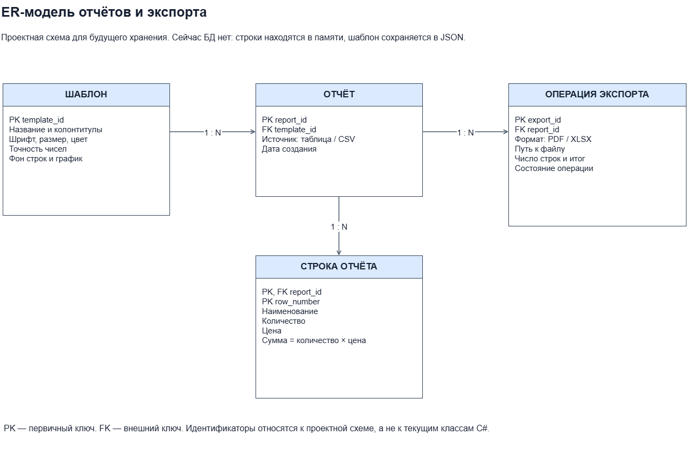
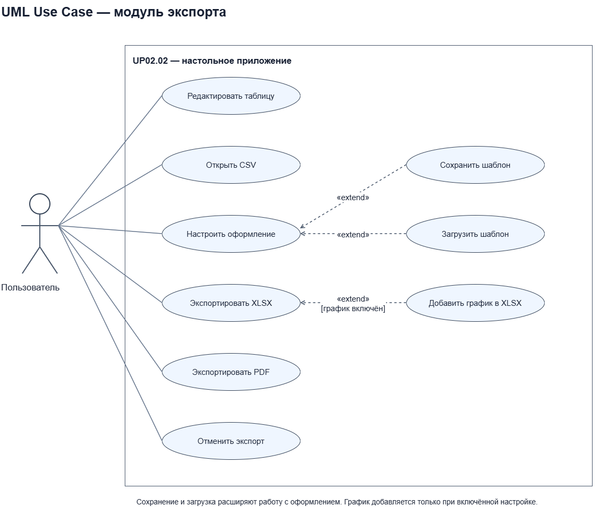
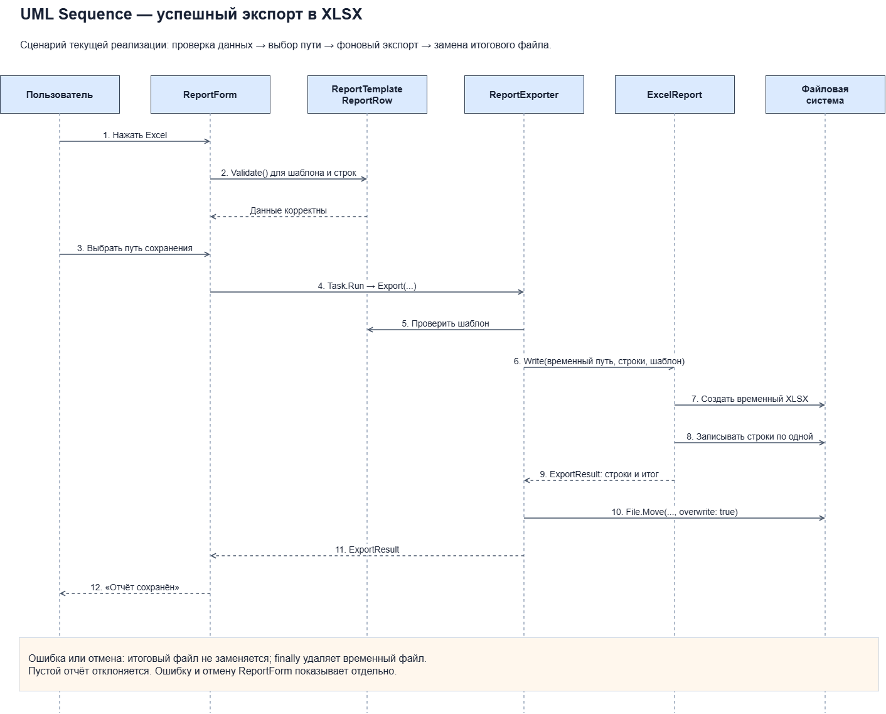

# Архитектура и диаграммы

Интерфейс написан на Windows Forms. Расчёты, проверка данных, чтение CSV и генераторы файлов вынесены в проект Core. Тестовый проект проверяет Core без запуска окна приложения.

| Файл или класс | Назначение |
| --- | --- |
| [Program.cs и ReportForm](../src/App/Program.cs) | Окно, таблица, настройки, диалоги, запуск фоновой операции и отмена |
| [ReportRow](../src/Core/Models.cs) | Название, количество, цена, расчёт суммы и проверка строки |
| [ReportTemplate](../src/Core/Models.cs) | Оформление, проверка настроек, сохранение и загрузка JSON |
| [CsvRows](../src/Core/Models.cs) | Последовательное чтение CSV через `TextFieldParser` |
| [ReportExporter](../src/Core/Models.cs) | Выбор генератора, временный файл и замена готового отчёта |
| [ExcelReport](../src/Core/ExcelReport.cs) | Запись XLSX через Open XML SDK, стили, итог, колонтитулы и график |
| [PdfReport](../src/Core/PdfReport.cs) | Постраничная генерация PDF через SkiaSharp |
| [ReportTests](../tests/ReportTests.cs) | Шесть проверок расчётов, оформления и генерации файлов |

## ER-модель

В текущей программе нет БД: строки находятся в `DataTable` или поступают из CSV, шаблон хранится в JSON. ER-диаграмма описывает проектную схему для возможного постоянного хранения. Таблицы и идентификаторы из неё пока не реализованы в приложении.

Один шаблон можно использовать для нескольких отчётов. Каждый отчёт содержит строки и может иметь несколько операций экспорта. `PK` обозначает первичный ключ, `FK` — внешний. У строки отчёта составной ключ: идентификатор отчёта и номер строки.

[Редактируемая ER-диаграмма](diagrams/er.drawio), [векторная версия](diagrams/er.svg).

## UML Use Case

Актор — пользователь настольного приложения. В границы системы входят подготовка таблицы, открытие CSV, оформление, экспорт и отмена. Администратор приложения не требуется. Сохранение и загрузка шаблона расширяют работу с оформлением; график расширяет экспорт XLSX при включённой настройке.

[Редактируемая Use Case](diagrams/use-case.drawio), [векторная версия](diagrams/use-case.svg).

## UML Sequence

Диаграмма показывает успешный экспорт XLSX из ручной таблицы. `ReportForm` завершает редактирование, проверяет шаблон и строки, получает путь сохранения и запускает `ReportExporter.Export` в фоне. Генератор пишет временный XLSX, затем `ReportExporter` заменяет итоговый файл и возвращает число строк и сумму.

Для CSV вместо снимка ручной таблицы передаётся последовательность `CsvRows.Read`. В PDF-сценарии вызывается `PdfReport.Write`.

[Редактируемая Sequence](diagrams/sequence.drawio), [векторная версия](diagrams/sequence.svg).

## Ошибки и отмена

Неверный ручной ввод отклоняется до выбора файла. При чтении CSV каждая строка проверяется во время обхода. Токен отмены передаётся генератору. Если запись завершилась с ошибкой или отменой, итоговый файл не заменяется, а временный удаляется в `finally`. Если строк нет, экспорт считается неуспешным.

В ручном режиме создаётся список текущих строк таблицы. Потоковая обработка большого источника относится прежде всего к CSV: весь CSV не копируется в список. В XLSX строки записываются через `OpenXmlWriter`; для графика отдельно запоминаются максимум 20 позиций.
