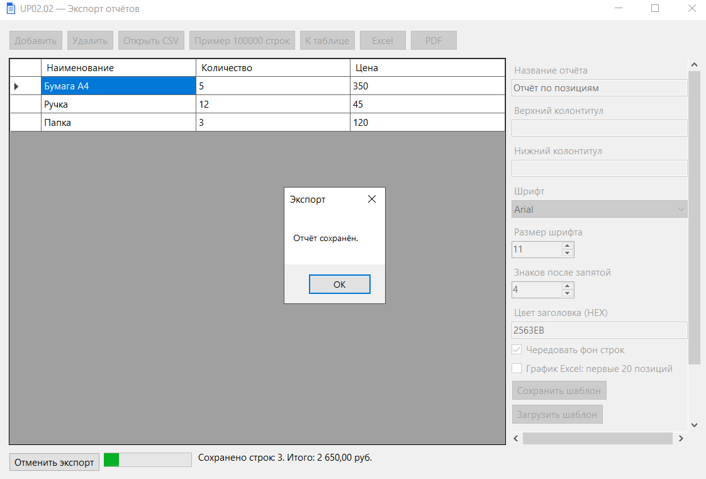
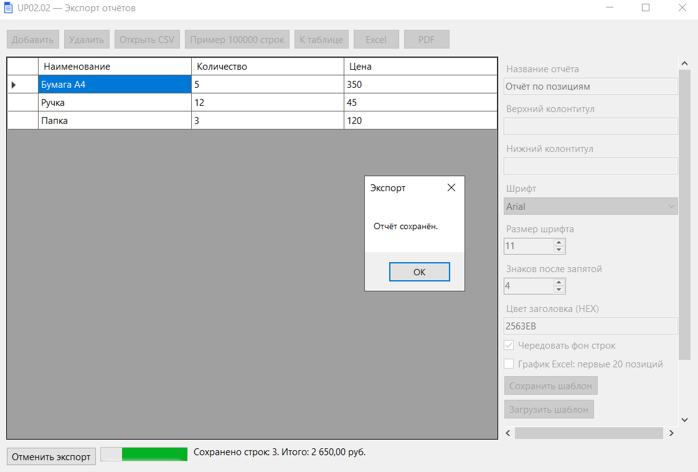
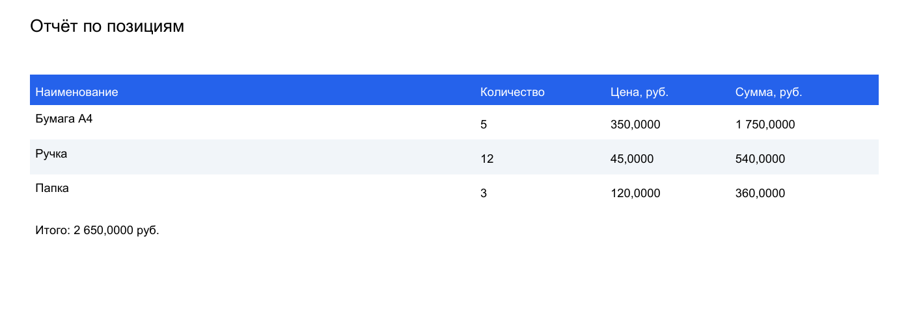
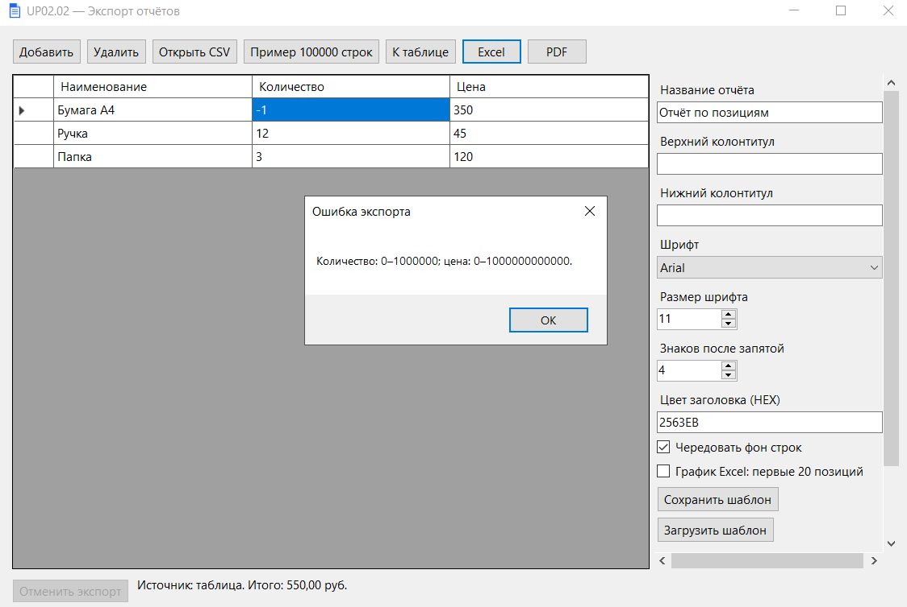
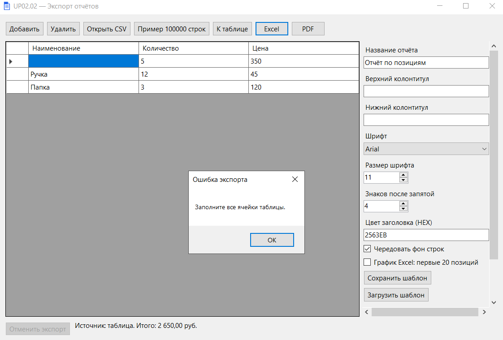
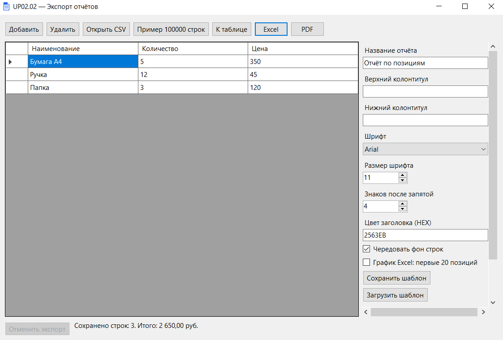
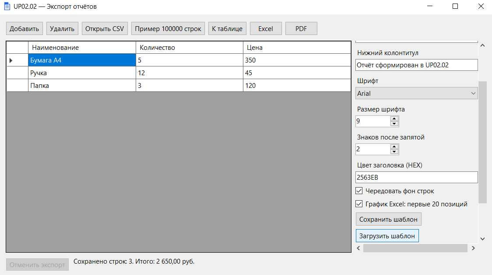

# Проверки приложения

Для проекта используются автотесты и проверки через окно приложения. Они проверяют разные части работы: автотесты сверяют данные и структуру файлов, а QA — поведение интерфейса и сообщения пользователю.

## Автоматические проверки

В [успешном CI main от 28 ноября 2026 года](https://github.com/GrowlHeart/MDK02.02/actions/runs/46140171729) прошли все 6 тестов. Из этого запуска сохранены [TRX](qa/coverage/tests.trx) и [Cobertura XML](qa/coverage/coverage.cobertura.xml).

| Тест | Что проверяет |
| --- | --- |
| `RowAmountUsesDecimal` | `3 × 0.1m` даёт ровно `0.3m` |
| `TemplateNumberFormatMatchesPrecision` | Точность шаблона отражается в формате чисел |
| `ExcelFormattingMatchesTemplate` | Заголовки, итог 2650, числовые типы, шрифт, цвет, колонтитулы и валидность XLSX |
| `ChartReferencesFirstTwentyRows` | Ссылки и данные графика охватывают первые 20 позиций; XLSX проходит валидатор |
| `LargeExcelReadsSourceOnce` | Источник из 100 000 строк читается один раз; число строк и итог совпадают |
| `PdfAcceptsStreamingRows` | Из последовательного источника из 1000 строк создаётся PDF с правильным результатом экспорта |

Первые два теста проверяют отдельную логику. Остальные создают файлы и проверяют работу экспорта. Полный код находится в [ReportTests.cs](../tests/ReportTests.cs).

| Покрытие Core | Результат |
| --- | --- |
| Строки | 189 из 210 — 90% |
| Ветви | 87 из 138 — около 63,04% |

Покрытие относится к коду Core, а не к интерфейсу Windows Forms. PDF-тест проверяет создание файла и результат экспорта; его читаемость проверяется отдельно. Сериализация JSON, неверные CSV, отмена и ошибки файловой системы не имеют отдельных тестов в текущем наборе из шести проверок.

Запуск локально из корня проекта:

```powershell
dotnet test tests/ReportExport.Tests.csproj -c Release --collect:"XPlat Code Coverage" --results-directory TestResults
```

## Проверки через интерфейс

Результаты записаны в [Issue #4](https://github.com/GrowlHeart/MDK02.02/issues/4). Использовались исходные строки: бумага 5 × 350, ручки 12 × 45, папки 3 × 120. Ожидаемый итог — 2650 рублей. Скриншоты повторных проверок предоставлены пользователем и сохранены без сжатия.

| № | Действия | Ожидаемый результат | Полученный результат |
| --- | --- | --- | --- |
| 1 | Экспортировать три строки в XLSX | Файл создаётся, данные и итог совпадают | Файл создан; при проверке содержимого XLSX итог 2650, суммы строк 1750, 540 и 360 |
| 2 | Экспортировать те же строки в PDF | Читаемый текст, таблица и итог | PDF создан; просмотр страницы подтвердил читаемую кириллицу и итог 2650 |
| 3 | Указать количество −1 и нажать Excel | Экспорт отклоняется | Показано сообщение о допустимых значениях; сохранение не начинается |
| 4 | Удалить название первой позиции и нажать Excel | Ошибка заполнения | Показано «Заполните все ячейки таблицы» |
| 5 | Указать имя файла и отменить сохранение | Файл не создаётся, окно продолжает работать | Файл `cancelled.xlsx` не появился; после отмены проверка продолжена |
| 6 | Сохранить шаблон, изменить название и загрузить шаблон | Сохранённое название восстанавливается | Название восстановилось, JSON сохранился без ошибки |

В этих шести сценариях дефекты не обнаружены. XLSX не открывался в настольном Excel: проверялось его содержимое. Скриншот после отмены показывает состояние приложения; отсутствие файла проверялось отдельно.

### Экспорт Excel



### Экспорт PDF





### Неверное количество



### Пустое название



### Отмена сохранения



### Загрузка шаблона



## Что дополнительно проверить

Перед защитой полезно открыть XLSX в Excel и проверить печать, выполнить отмену во время большого экспорта, попробовать занятый файл и неверный CSV. Это дополнительные сценарии; успешными здесь считаются только шесть проверок выше. Найденный дефект оформляется отдельным Issue с шагами, ожидаемым и фактическим результатом, скриншотом и приоритетом P1/P2/P3.
